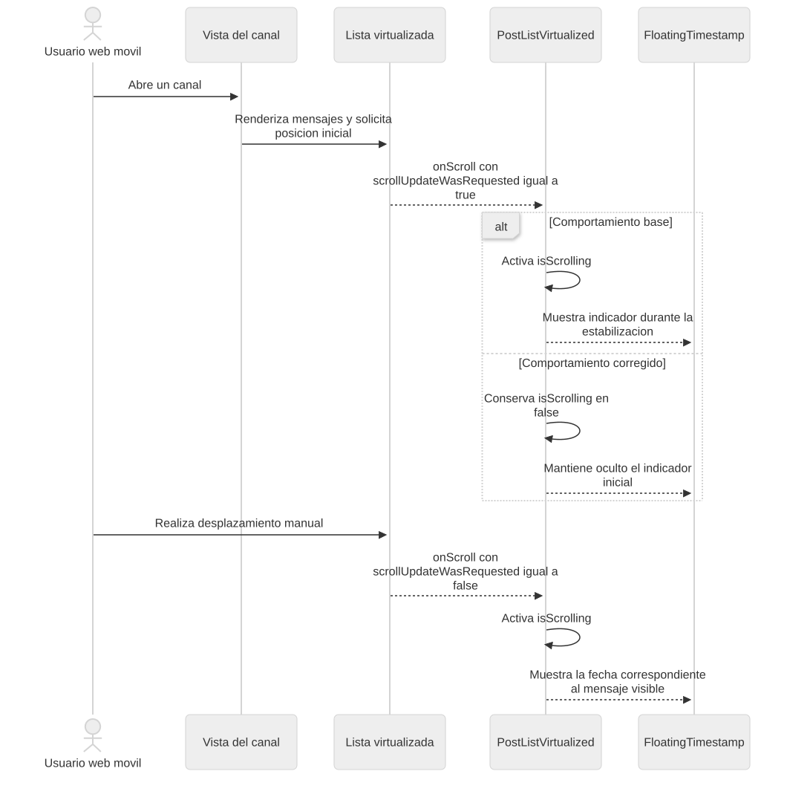
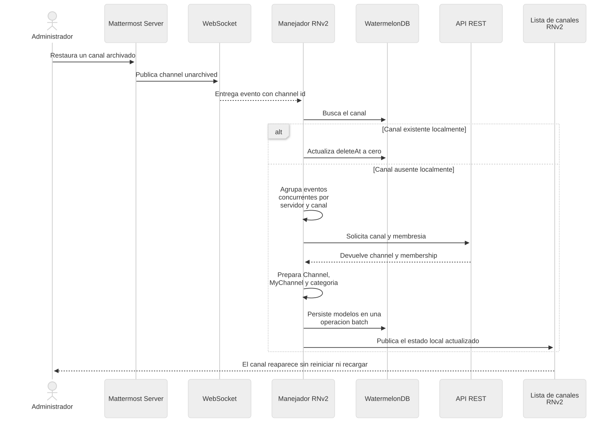

# Arquitectura y proceso — proyecto final PSWE07

Este directorio contiene la arquitectura como código y los flujos de proceso del proyecto académico **Mejoras de consistencia y sincronización en Mattermost**, desarrollado para el curso PSWE07 — Procesos y Administración de Software.

Fecha de corte documental: **22 de noviembre de 2026**.

## Alcance

El proyecto estudia dos correcciones acotadas en forks académicos:

- [Issue web #38666](https://github.com/mattermost/mattermost/issues/38666): activación inicial del indicador flotante de fecha durante un desplazamiento programático de la lista virtualizada.
- [Issue móvil #26673](https://github.com/mattermost/mattermost-mobile/issues/26673): restauración de un canal que todavía no existe en la base local de RNv2.

La documentación no pretende describir toda la plataforma Mattermost. Los diagramas se limitan a las personas, contenedores, relaciones y secuencias necesarias para comprender ambos cambios.

## Índice de artefactos

| Vista | Fuente editable | Representación generada | Propósito |
|---|---|---|---|
| C4 nivel 1 — contexto | [c4_context.mmd](architecture/c4_context.mmd) | [c4_context.svg](architecture/c4_context.svg) | Presenta Mattermost como un único sistema, sus personas usuarias y relaciones. |
| C4 nivel 2 — contenedores | [c4_container.mmd](architecture/c4_container.mmd) | [c4_container.svg](architecture/c4_container.svg) | Abre el límite de Mattermost y muestra los clientes, servidor y persistencias relevantes. |
| Secuencia web #38666 | [issue_38666_sequence.mmd](architecture/issue_38666_sequence.mmd) | [issue_38666_sequence.svg](architecture/issue_38666_sequence.svg) | Contrasta el desplazamiento programático con el manual. |
| Secuencia móvil #26673 | [issue_26673_sequence.mmd](architecture/issue_26673_sequence.mmd) | [issue_26673_sequence.svg](architecture/issue_26673_sequence.svg) | Muestra recuperación, preparación y persistencia cuando el canal está ausente localmente. |
| Proceso observado | [process_as_is.mmd](process/process_as_is.mmd) | [process_as_is.svg](process/process_as_is.svg) | Reconstruye el flujo demostrado por ramas, PR y Actions. |
| Proceso propuesto | [process_to_be.mmd](process/process_to_be.mmd) | [process_to_be.svg](process/process_to_be.svg) | Define los controles recomendados para el cierre y futuras iteraciones. |

## C4 nivel 1 — contexto

El nivel de contexto conserva a Mattermost como un único sistema. Muestra dos personas:

- La persona usuaria de canales, que consulta mensajes y canales desde web móvil o RNv2.
- La persona administradora del espacio, que archiva y restaura canales.



## C4 nivel 2 — contenedores relevantes

El nivel de contenedores abre el límite del sistema únicamente para mostrar los elementos afectados:

- Webapp Channels en TypeScript y React.
- Cliente móvil RNv2 en TypeScript y React Native.
- Mattermost Server en Go, REST y WebSocket.
- WatermelonDB sobre SQLite como base local móvil.
- PostgreSQL como persistencia autoritativa del servidor.



## Secuencias técnicas

### Web #38666

El flujo diferencia `scrollUpdateWasRequested=true`, originado por el componente, de un desplazamiento manual. La corrección evita activar `isScrolling` durante la estabilización programática y conserva el indicador cuando la persona desplaza la lista.



### Móvil #26673

El manejador consulta primero la base local. Cuando el canal no existe, recupera canal y membresía, prepara `Channel`, `MyChannel` y su categoría, persiste el lote y permite que la lista móvil observe el nuevo estado.



## Proceso observado

El proceso observado se reconstruyó a partir de evidencia verificable: issues upstream, bases fijadas, ramas, commits, pull requests y GitHub Actions. No inventa Issues académicos ni reviews que no se realizaron.

Al corte documental:

- El [PR web #1](https://github.com/thegabrielobo/mattermost/pull/1) continúa abierto y sin review formal.
- El [PR móvil #1](https://github.com/thegabrielobo/mattermost-mobile/pull/1) continúa abierto y requiere cierre independiente en su repositorio.
- La decisión de integrar, cerrar sin integrar o mantener abiertos los cambios sigue pendiente.


## Proceso propuesto

El flujo propuesto agrega los controles que faltaron o se aplicaron tardíamente:

1. Issue académico con criterios de aceptación.
2. Responsable y revisor nominales.
3. Base y entorno reproducibles.
4. Evidencia inicial o prueba roja.
5. Rama y cambio acotado.
6. Pruebas y evidencia antes/después.
7. Pull request con checklist.
8. Quality gates definidos.
9. Review formal por otra persona.
10. Validación por criterio.
11. Decisión registrada de integración, cierre o no integración.
12. Actualización de métricas, riesgos, costos y lecciones.


## Evidencia relacionada

| Evidencia | Resultado al corte | Enlace |
|---|---|---|
| Pruebas focalizadas web | 36/36 aprobadas | [Action 43106817272](https://github.com/thegabrielobo/mattermost/actions/runs/43106817272) |
| CI general web | Controles visibles aprobados | [Action 43106817307](https://github.com/thegabrielobo/mattermost/actions/runs/43106817307) |
| Comparación visual web | Ejecución exitosa; aceptación W2 inconclusa | [Action 43276950292](https://github.com/thegabrielobo/mattermost/actions/runs/43276950292) |
| Pruebas focalizadas móvil | 137/137 aprobadas | [Action 43101844095](https://github.com/thegabrielobo/mattermost-mobile/actions/runs/43101844095) |

Una ejecución exitosa demuestra que los pasos del workflow terminaron, pero no sustituye la aceptación funcional. En particular, el ensayo visual web demostró el efecto sobre la activación inicial del indicador, pero la base no reprodujo la fecha incorrecta; por ello W2 permanece inconcluso.

## Regeneración

Los archivos `.mmd` son la fuente de verdad editable. Los SVG se generaron con Mermaid CLI. Desde la raíz del repositorio pueden regenerarse con:

```bash
for source in academic/final/architecture/*.mmd; do
    npx -y @mermaid-js/mermaid-cli -i "$source" -o "${source%.mmd}.svg"
done

for source in academic/final/process/*.mmd; do
    npx -y @mermaid-js/mermaid-cli -i "$source" -o "${source%.mmd}.svg"
done
```

La regeneración requiere Node.js, npm y acceso al paquete `@mermaid-js/mermaid-cli`. Una modificación del SVG sin modificar primero la fuente Mermaid no debe considerarse fuente de verdad.

## Convenciones y límites

- Los diagramas C4 siguen los niveles de contexto y contenedores del modelo de Simon Brown.
- Las secuencias complementan C4; no representan niveles adicionales del modelo.
- `process_as_is` describe lo comprobado al corte.
- `process_to_be` es una propuesta de gobernanza y no debe presentarse como proceso ya ejecutado.
- Los forks académicos no representan una decisión de integración del proyecto upstream.
- La arquitectura puede evolucionar si cambia el alcance técnico; en ese caso deben actualizarse fuente Mermaid y SVG en el mismo commit.

## Referencias

- Simon Brown, *The C4 model for visualising software architecture*.
- [Mermaid — C4 diagrams](https://mermaid.js.org/syntax/c4.html).
- [Mattermost web fork](https://github.com/thegabrielobo/mattermost).
- [Mattermost mobile fork](https://github.com/thegabrielobo/mattermost-mobile).
