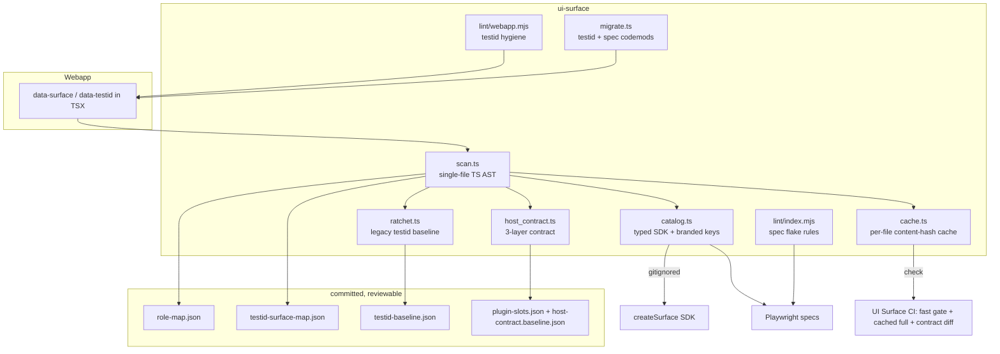

# UI Surface — design (lean v2)

A lean, additive, self-maintaining alternative to a heavy static-analysis stack. One attribute (`data-surface`), a
single-file AST scanner, a handful of ESLint rules, and small committed contracts (role map, drift map, testid ratchet,
plugin slots). It scans the whole webapp in ~3s cold / ~1.4s warm, commits no generated report, and merges cleanly with
master.

## Architecture

Everything the scanner needs is a single file's AST (`ts.createSourceFile`, no `ts.createProgram`, no type program),
so it is fast and pins to `typescript@6` without coupling to `typescript@7` (which has no `createProgram`). Cross-file
concerns (duplicate ids across files, stale references, the ratchet) are cheap aggregations over the per-file results,
which is also what makes the content-hash incremental cache correct.

## Dev workflow by persona

- **Product engineer** — add `data-surface='scope.name[:key]--role'`. `ui-surface check` (local + CI) flags grammar,
  role-fit, key-origin and duplicates; the ratchet blocks new free-form `data-testid`s. `ui-surface explain <rule>`
  gives the fix.
- **SDET** — reach elements through `createSurface(page)`; keyed parts take branded key types where the key is a known
  entity. Spec ESLint rules (observe-actions, no-floating-actions, no-url-assertions, no-conditional-logic, ...) catch
  flake; the per-directory strict ratchet (`strict-specs.json`) turns warnings into errors as directories are cleaned.
- **Renamer** — `ui-surface migrate-testid` rewrites Jest/Cypress lookups and renames the component's legacy id to the
  surface id (dry-run by default); `ui-surface drift --update` and `ui-surface baseline --update` keep the contracts honest.
- **Plugin author** — `plugin-slots.json` lists each host slot, its registry method(s) and host render file; the
  host-contract diff in CI blocks breaking removals across slots, APIs and the plugin registry.

## Fails loudly vs silently

| Fails loudly (CI error) | Only warns / editor feedback | Intentionally silent |
| --- | --- | --- |
| Invalid grammar, duplicate id, role-fit, key-origin, drift, stale reference, **new** legacy testid (ratchet), breaking host-contract change, surface type errors (`tsc`) | Spec flake rules on non-strict directories; webapp `data-testid` hygiene (eslint `--quiet`) | Existing legacy testids within the baseline; dynamic `data-testid` paired with a `data-surface`; cross-module key origins (single-file by design) |

## Maintenance burden

The committed contracts are small and diff-friendly: `testid-baseline.json` is one line per file (48 KB, shrink-only),
`testid-surface-map.json` is 29 pairings, `role-map.json` is a short list, `plugin-slots.json` is 13 slots. No 700 KB
generated report is committed; the SDK is regenerated and gitignored. Core (non-test) code grew from 2,041 to 3,205 LOC
to close the gaps — still about an eighth of the heavy stack's ~24,500 LOC.

## Where Peter's design is still stronger (with data)

- **observe-actions precision.** Peter's rule uses the TypeScript type checker, so it recognises page-object helpers as
  observing. Over 247 real channel specs, lean (type-free) reported 26 findings across 15 files that Peter did not
  (`bench/results/observe-compare.json`); several are false positives at helper boundaries lean cannot see through. Lean
  has no false negatives on straight-line code but over-reports here.
- **No-literal-locators.** Peter bans literal `getByTestId`/`getByRole` in specs entirely (page-objects only); lean
  permits `getByTestId`. Peter's guarantee is stronger (in the benchmark he flags a `getByTestId` sample lean treats as
  clean).
- **Key-origin provenance.** Peter proves a key's origin against registered entity types (it even rejected a synthetic
  `.id` whose type was not registered). Lean resolves local aliases by field name and brands a few known entities, but
  does not prove the type. Lean is stricter on array-index keys (it rejects them; Peter permits position keys).
- **Whole-program reachability & value tracing.** Peter follows prop/value flow across modules and reports unreachable
  testids. Lean is single-file and does not trace cross-component dataflow.

These cost Peter ~5 min and ~3.5 GB per scan; lean trades that precision for ~3s / ~330 MB and an additive footprint.
See `bench/report.html` for the full matrix and timings.
