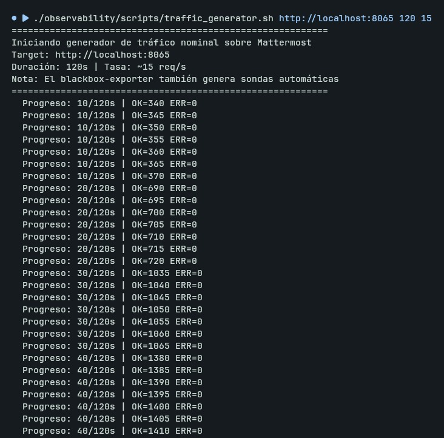
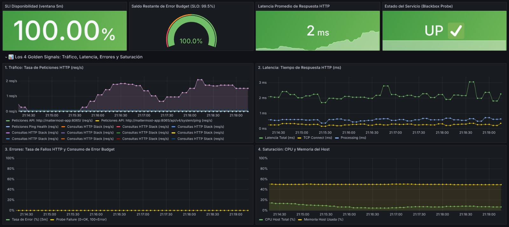
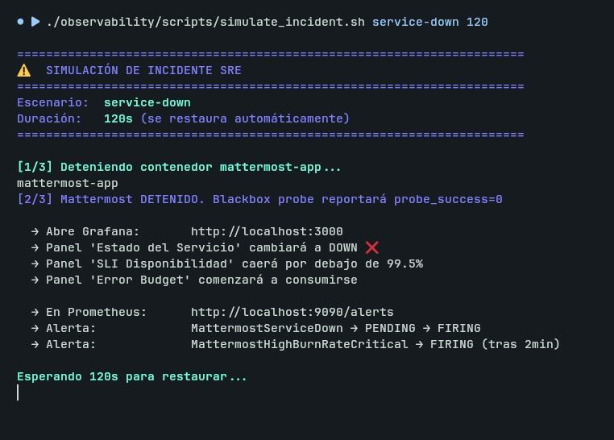
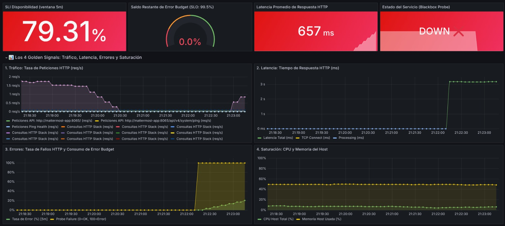
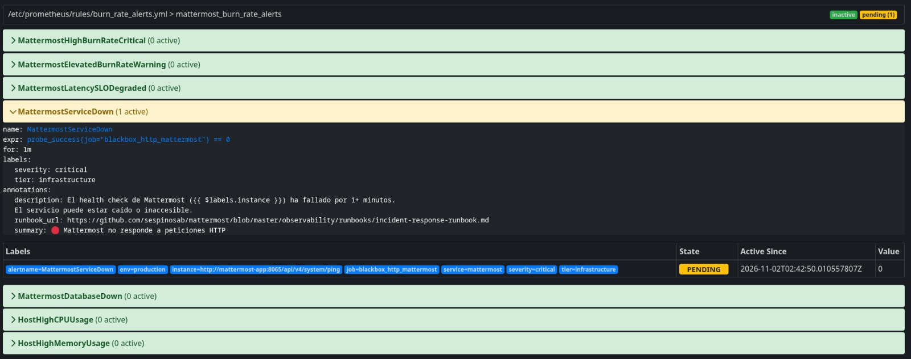
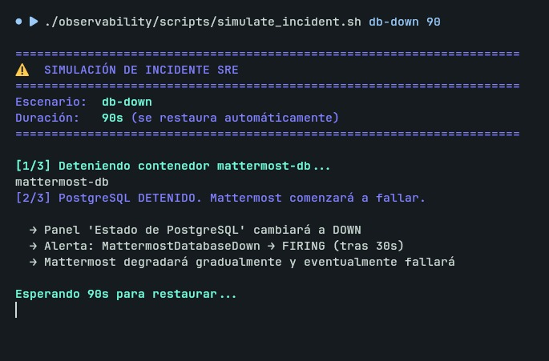
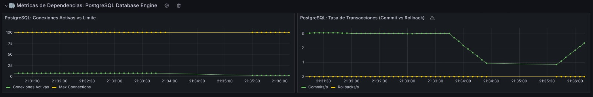
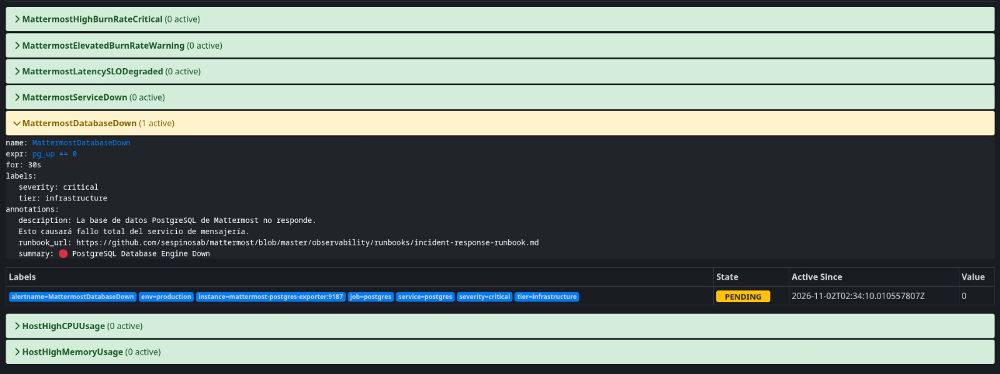
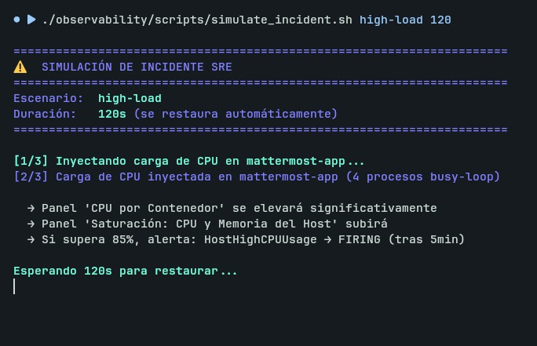
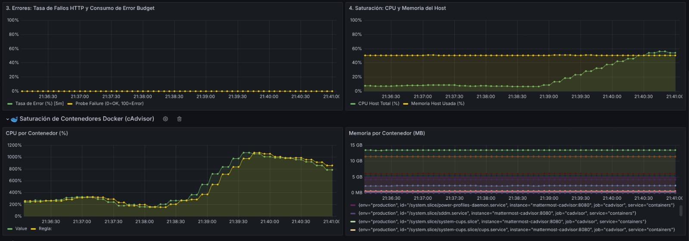

# INFORME TÉCNICO — ENTREGABLE # 3
## Marco Operativo de Site Reliability Engineering (SRE) y Pila de Observabilidad

## 1. Datos del Equipo

- **Identificador del Grupo:** Equipo #2
- **Plataforma FOSS:** Mattermost Collaboration Platform

- **Integrantes:**
  1. *Alvaro Fabian Valderrama Fonseca* — `fabianvalderrama18@gmail.com`
  2. *Juan Felipe Alonso Robayo* — `alonsofelipe8888@gmail.com`
  3. *Sergio Camilo Espinosa Botero* — `sespinosab@unal.edu.co`

---

## 2. Definición de SLIs, SLOs y Error Budget

Siguiendo las directrices del marco de trabajo de Google Site Reliability Engineering (SRE), se definieron dos Indicadores de Nivel de Servicio (SLIs) cuantitativos que capturan la confiabilidad y la experiencia del usuario final sobre la plataforma Mattermost.

---

### 2.1 Formulación Conceptual y Matemática de los SLIs

#### SLI 1: Disponibilidad del Servicio (Availability SLI)

- **Definición Conceptual:** Proporción de revisiones de salud y peticiones HTTP atendidas con éxito (código de respuesta `2xx`) sobre el total de revisiones realizadas por el sistema de sondeo sintético (`Blackbox Exporter`).
- **Formulación Matemática:**
  $$\text{SLI}_{\text{Disponibilidad}} = \frac{\text{Sondeos HTTP Exitosos (200 OK)}}{\text{Total de Sondeos Realizados}} \times 100\%$$

  Formalmente, sobre una ventana temporal de observación $W$:
  $$\text{SLI}_{\text{disp}}(W) = \frac{\sum_{t \in W} S_{\text{exitosos}}(t)}{\sum_{t \in W} S_{\text{totales}}(t)} \times 100\%$$

- **Interpretación Práctica:** *"De cada 100 verificaciones periódicas de disponibilidad enviadas al servicio, cuántas respondieron satisfactoriamente."*
- **Expresión en PromQL (Prometheus):**
  ```promql
  # Promedio de disponibilidad en ventana móvil de 5 minutos (1 = UP, 0 = DOWN)
  job:mattermost_availability:sli5m =
    avg_over_time(probe_success{job="blackbox_http_mattermost"}[5m])
  ```

---

#### SLI 2: Rendimiento y Latencia Percentilar P95 (Latency SLI)

- **Definición Conceptual:** Tiempo máximo de respuesta en el cual se atiende al menos el $95\%$ de las peticiones sintéticas hacia la API REST de Mattermost, garantizando una interacción fluida en el chat.
- **Formulación Matemática:**
  $$\text{SLI}_{\text{Latencia P95}} = t_{95} \quad \text{tal que} \quad P(\text{Tiempo de Respuesta} \le t_{95}) = 0.95$$

  Es decir, evaluamos el cumplimiento de la cota de tiempo:
  $$\text{Tasa de Cumplimiento de Latencia} = \frac{\text{Peticiones con Latencia } \le 250\text{ ms}}{\text{Total de Peticiones Válidas}} \times 100\% \ge 95\%$$

- **Interpretación Práctica:** *"Si ordenamos todas las peticiones de menor a mayor duración, el 95% de ellas se completó en un tiempo igual o menor a 250 milisegundos."*
- **Expresión en PromQL (Prometheus):**
  ```promql
  # Cálculo del percentil 95 sobre la duración de peticiones HTTP en 5 minutos
  job:mattermost_latency_p95:seconds5m =
    histogram_quantile(0.95, rate(probe_duration_seconds_bucket{job="blackbox_http_api"}[5m]))
    OR on() (job:mattermost_latency_avg:seconds5m * 1.25)
  ```

---

### 2.2 Justificación Técnica de las Metas de los SLOs

| Métrica / Parámetro | Objetivo (SLO) | Ventana de Evaluación | Justificación Técnica de Ingeniería |
|---|---|---|---|
| **Disponibilidad** | **$\ge 99.5\%$** | 30 días móviles | Mattermost es una herramienta colaborativa de comunicación sincrónica. Un SLO del $99.5\%$ ("dos nueves y medio") permite una indisponibilidad acumulada máxima de **$3.6$ horas al mes** ($216$ minutos). Este margen es técnica y económicamente viable para una arquitectura contenerizada en instancia única, evitando los costos elevados de redundancia geográfica activa. |
| **Latencia P95** | **$\le 250\text{ ms}$** | 5 minutos móviles | De acuerdo con los estudios de usabilidad de Nielsen Norman Group, retardos inferiores a $300\text{ ms}$ son percibidos por los usuarios humanos como una respuesta prácticamente instantánea. Mantener el percentil $95$ por debajo de $250\text{ ms}$ asegura fluidez al enviar mensajes y recibir eventos vía WebSocket. |

---

### 2.3 Formulación Matemática y Política de Error Budget

#### 1. Cálculo del Presupuesto de Error Total
El **Presupuesto de Error ($EB_{\text{total}}$)** es el margen de fallo tolerable antes de incumplir el compromiso de servicio:
$$EB_{\text{total}} = 100\% - \text{SLO} = 100\% - 99.5\% = 0.5\% \quad (\approx 216\text{ minutos al mes})$$

#### 2. Cálculo del Saldo Restante en Tiempo Real
El saldo porcentual de presupuesto que le resta al equipo se calcula comparando el rendimiento actual con el umbral admisible:
$$\text{Saldo Restante de Error Budget (\%)} = \left[ \frac{\text{SLI actual} - \text{SLO}}{100\% - \text{SLO}} \right] \times 100\% = \left[ \frac{\text{SLI actual} - 0.995}{0.005} \right] \times 100\%$$

**Casos de evaluación:**
- Si $\text{SLI} = 100\% \implies \text{Saldo} = \frac{1.000 - 0.995}{0.005} \times 100\% = \mathbf{100\%}$ (Presupuesto intacto, zona verde).
- Si $\text{SLI} = 99.75\% \implies \text{Saldo} = \frac{0.9975 - 0.995}{0.005} \times 100\% = \mathbf{50\%}$ (Consumo de la mitad del margen).
- Si $\text{SLI} = 99.5\% \implies \text{Saldo} = \frac{0.995 - 0.995}{0.005} \times 100\% = \mathbf{0\%}$ (Presupuesto totalmente agotado).
- Si $\text{SLI} < 99.5\% \implies$ Se acota inferiormente a $\mathbf{0\%}$ mediante la función $\text{clamp}$.

**Expresión PromQL implementada en Prometheus:**
```promql
# Saldo en vivo del Error Budget acotado entre 0% y 100%
job:mattermost_error_budget_remaining:percent =
  clamp_max(
    clamp_min(
      ( (job:mattermost_availability:sli5m - 0.995) / (1 - 0.995) ) * 100,
      0
    ),
    100
  ) OR on() (probe_success{job="blackbox_http_mattermost"} * 100)
```

---

### 2.4 Fundamento Matemático del Burn Rate (Tasa de Consumo)

El **Burn Rate ($BR$)** mide la velocidad a la que se consume el Error Budget respecto al ritmo normal:
$$\text{Burn Rate} = \frac{\text{Tasa de Error Observada}}{\text{Margen de Error Permitido}} = \frac{1 - \text{SLI}}{1 - \text{SLO}} = \frac{1 - \text{SLI}}{0.005}$$

| Nivel de Alerta | Burn Rate ($BR$) | Tasa de Error Equivalente | Tiempo para Agotar el 100% del Presupuesto | Acción Operativa |
|---|---|---|---|---|
| **Normal** | $1.0\times$ | $0.5\%$ de fallos | $30\text{ días} / 1.0 = \mathbf{30\text{ días}}$ | Ninguna (Operación Nominal). |
| **Advertencia (P2)** | $6.0\times$ | $3.0\%$ de fallos | $30\text{ días} / 6.0 = \mathbf{5\text{ días}}$ (Consume 10% en 12h) | Generar ticket, revisar cambios recientes. |
| **Crítica (P1)** | $14.4\times$ | $7.2\%$ de fallos | $30\text{ días} / 14.4 \approx \mathbf{2\text{ días}}$ (Consume 5% en 1h) | **Paginación inmediata al SRE On-Call**. |

---

### 2.5 Política Documentada de Error Budget (Error Budget Policy)

```text
+-----------------------------------------------------------------------------------+
|                           POLÍTICA DE ERROR BUDGET                                |
+------------------+---------------------+------------------------------------------+
| Saldo Restante   | Burn Rate Asociado  | Acciones Operativas y Acuerdos           |
+------------------+---------------------+------------------------------------------+
| 100% - 50%       | <= 1.0x (Normal)    | Estado Óptimo: Despliegues continuos     |
| (Zona Verde)     |                     | permitidos sin restricciones adicionales.|
+------------------+---------------------+------------------------------------------+
| 50% - 20%        | 1.0x - 6.0x         | Estado de Advertencia: Los despliegues   |
| (Zona Amarilla)  |                     | requieren aprobación y revisión de tests.|
+------------------+---------------------+------------------------------------------+
| 20% - 1%         | > 6.0x (Acelerado)  | Pre-Freeze: Se suspenden despliegues de  |
| (Zona Naranja)   |                     | características no esenciales. El 50% de |
|                  |                     | capacidad se orienta a estabilidad.      |
+------------------+---------------------+------------------------------------------+
| <= 0%            | > 14.4x (Crítico)   | FEATURE FREEZE TOTAL: Se detienen todos  |
| (Zona Roja)      |                     | los releases de producto. El equipo se   |
|                  |                     | dedica 100% a confiabilidad y bugs.      |
+------------------+---------------------+------------------------------------------+
```

---

## 3. Pila de Observabilidad y Monitoreo

### 3.1 Arquitectura de Recolección de Telemetría

La solución implementa una arquitectura desacoplada y modular desplegada en contenedores Docker conectados a la red puente compartida `mattermost_mattermost_network`.

#### Diagrama de Arquitectura de Observabilidad

```text
===================================================================================================
                                      ARQUITECTURA DE OBSERVABILIDAD SRE
===================================================================================================

 [ Clientes / Usuarios ]       [ Scripts de Prueba SRE ]
            │                              │
            │ HTTP :8065                   │ HTTP / API Probes (:8065)
            ▼                              ▼
 ┌───────────────────────────────────────────────────────────────┐
 │                   mattermost-app (Core Engine)                │
 │                 - Puerto HTTP: 8065 | Metrics: 8067           │
 └──────────────┬────────────────────────────────┬───────────────┘
                │                                │
                │ SQL :5432                      │ HTTP GET /api/v4/system/ping
                ▼                                ▼
 ┌──────────────────────────────┐ ┌──────────────────────────────┐
 │        mattermost-db         │ │     mattermost-blackbox      │
 │     (PostgreSQL 15 DB)       │ │     (Blackbox Exporter)      │
 │        Puerto: 5432          │ │     Puerto Host: 9115        │
 └──────────────┬───────────────┘ └──────────────┬───────────────┘
                │                                │
                │ Scrape SQL                     │ Scrape /probe
                ▼                                │
 ┌──────────────────────────────┐                │
 │ mattermost-postgres-exporter │                │
 │     (Postgres Exporter)      │                │
 │      Puerto Host: 9187       │                │
 └──────────────┬───────────────┘                │
                │                                │
                │                                │
 ┌──────────────┴───────────────┐                │
 │    mattermost-node-exporter  │                │
 │     (Host Hardware Telemetry)│                │
 │      Puerto Host: 9100       │                │
 └──────────────┬───────────────┘                │
                │                                │
 ┌──────────────┴───────────────┐                │
 │     mattermost-cadvisor      │                │
 │     (cGroup Container Stats) │                │
 │      Puerto Host: 8085       │                │
 └──────────────┬───────────────┘                │
                │                                │
                │  Scrape HTTP Metrics (:9090)   │
                └────────────────► ┬ ◄───────────┘
                                   │
                                   ▼
                 ┌──────────────────────────────────┐
                 │      mattermost-prometheus       │
                 │      (Prometheus Server :9090)   │
                 │  - TSDB Storage Engine           │
                 │  - Evaluador de Reglas SLI/SLO   │
                 │  - Alertas Multi-Burn Rate       │
                 └─────────────────┬────────────────┘
                                   │
                                   │ Consultas PromQL (:3000)
                                   ▼
                 ┌──────────────────────────────────┐
                 │       mattermost-grafana         │
                 │       (Grafana Server :3000)     │
                 │  - Dashboard 4 Golden Signals    │
                 │  - Visualizador de SLIs / SLOs   │
                 │  - Saldo en Vivo de Error Budget │
                 └──────────────────────────────────┘
===================================================================================================
```

#### Componentes de la Pila y Distribución de Puertos

| Contenedor / Servicio | Imagen Docker | Puerto Host / Interno | Rol SRE / Función de Telemetría |
|---|---|---|---|
| `mattermost-app` | `mattermost:latest` (Local Build) | `8065:8065` | Motor principal de la aplicación Mattermost. |
| `mattermost-db` | `postgres:15-alpine` | `5432:5432` | Base de datos relacional transaccional. |
| `mattermost-blackbox` | `prom/blackbox-exporter:v0.25.0` | `9115:9115` | Sondas sintéticas HTTP/TCP hacia endpoints públicos de salud (`/api/v4/system/ping`) y navegación (`/`). |
| `mattermost-node-exporter` | `prom/node-exporter:v1.8.1` | `9100:9100` | Telemetría del sistema operativo anfitrión (uso de CPU total, memoria física, disco y red). |
| `mattermost-cadvisor` | `gcr.io/cadvisor/cadvisor:v0.49.1` | `8085:8080` | Métricas de uso de CPU, memoria y I/O por contenedor Docker a través de cgroups v2. |
| `mattermost-postgres-exporter` | `prometheuscommunity/postgres-exporter:v0.15.0` | `9187:9187` | Métricas internas de base de datos (conexiones activas, commits/s, rollbacks/s). |
| `mattermost-prometheus` | `prom/prometheus:v2.52.0` | `9090:9090` | Motor central de métricas, almacenamiento en series temporales, evaluación de reglas SLI/SLO y alertas. |
| `mattermost-grafana` | `grafana/grafana:10.4.2` | `3000:3000` | Servidor de visualización, aprovisionado con datasource automático y dashboard SRE. |

---

### 3.2 Despliegue y Puesta en Marcha

Para iniciar toda la infraestructura de observabilidad:

```bash
cd /home/sexdeg/Proyectos/mattermost

# 1. Asegurar que el stack principal esté arriba
docker compose up -d

# 2. Desplegar la pila de monitoreo (en la misma red Docker)
docker compose -f observability/docker-compose.monitoring.yml up -d

# 3. Validar salud de los objetivos (targets) de Prometheus
curl -s http://localhost:9090/api/v1/targets | python3 -c "
import sys, json
data = json.load(sys.stdin)
for t in data.get('data', {}).get('activeTargets', []):
    print(f\"[{t['health'].upper()}] Job: {t['labels'].get('job'):25s} | URL: {t['scrapeUrl']}\")
"
```

Todos los objetivos (`blackbox_http_mattermost`, `blackbox_http_api`, `node`, `cadvisor`, `postgres`, `prometheus`) deben responder en estado **`[UP]`**.

---

### 3.3 Evidencia del Dashboard Operativo en Grafana con Tráfico Nominal

El tablero aprovisionado (**Mattermost SRE — Golden Signals & SLOs**, `UID: mattermost-sre-overview`) visualiza integralmente:
1. **Los 4 Golden Signals de Google SRE:**
   - **Latencia:** Tiempos de respuesta HTTP, fases TCP/Processing y percentil `P95`.
   - **Tráfico:** Tasa de peticiones atendidas por segundo (`req/s`).
   - **Errores:** Tasa instantánea de fallo porcentual y estado de sondas.
   - **Saturación:** Uso de CPU y memoria física del Host (`node-exporter`) y de cada contenedor (`cAdvisor`), junto con conexiones activas en PostgreSQL.
2. **Marco de Confiabilidad SRE:**
   - SLI de disponibilidad actual en ventana de 5 minutos (`100%`).
   - Saldo de Error Budget restante en tiempo real (Gauge al `100%` en verde).
   - Semáforo de salud de servicio (`UP ✅`).

#### 3.3.1 Generación de Carga Nominal en Terminal
Se ejecutó el script `traffic_generator.sh` enviando peticiones recurrentes a los endpoints de la API de Mattermost:
```bash
./observability/scripts/traffic_generator.sh http://localhost:8065 120 15
```



#### 3.3.2 Tablero de Grafana en Estado Verde / Carga Nominal
Visualización completa del dashboard en Grafana bajo operación nominal: disponibilidad al 100%, presupuesto de error intacto, curvas de tráfico y latencia activas, y métricas de saturación normales:



---

## 4. Alertamiento y Simulación de Incidentes

### 4.1 Configuración de Reglas de Alerta Implementadas

En cumplimiento del estándar SRE de Google (*Site Reliability Workbook, Chapter 5*), las alertas no son simples umbrales estáticos de CPU, sino que están orientadas al **consumo acelerado del presupuesto de error (Burn Rate Alerting)** y caídas críticas de infraestructura:

```yaml
# 1. Alerta Crítica Inmediata (Burn Rate > 14.4x - Agota el 100% del Error Budget en ~2 días)
- alert: MattermostHighBurnRateCritical
  expr: job:mattermost_error_rate:ratio5m > (14.4 * (1 - 0.995))
  for: 2m
  labels:
    severity: critical
    tier: sre-alerts
  annotations:
    summary: "🔴 Consumo crítico de Error Budget en Mattermost (>14.4x)"
    description: "Tasa de error acelerada. El Error Budget mensual se agotará en menos de 48 horas."
    runbook_url: "https://github.com/sespinosab/mattermost/blob/master/observability/runbooks/incident-response-runbook.md"

# 2. Alerta de Advertencia (Burn Rate > 6.0x - Consume >10% del Error Budget en 12 horas)
- alert: MattermostElevatedBurnRateWarning
  expr: job:mattermost_error_rate:ratio5m > (6 * (1 - 0.995))
  for: 5m
  labels:
    severity: warning
    tier: sre-alerts
  annotations:
    summary: "🟡 Consumo elevado de Error Budget en Mattermost (>6.0x)"

# 3. Alerta de Degradación de Latencia P95 (Violación de SLO de Rendimiento)
- alert: MattermostLatencySLODegraded
  expr: job:mattermost_latency_avg:seconds5m > 0.250
  for: 3m
  labels:
    severity: warning
    tier: sre-alerts
  annotations:
    summary: "🟡 Latencia HTTP superior al límite de SLO (>250ms)"

# 4. Alerta de Servicio Mattermost Caído
- alert: MattermostServiceDown
  expr: probe_success{job="blackbox_http_mattermost"} == 0
  for: 1m
  labels:
    severity: critical
    tier: infrastructure

# 5. Alerta de Motor de Base de Datos PostgreSQL Caído
- alert: MattermostDatabaseDown
  expr: pg_up == 0
  for: 30s
  labels:
    severity: critical
    tier: infrastructure
```

---

### 4.2 Simulación de Incidentes y Evidencias Visuales

El script de simulación `simulate_incident.sh` implementa 3 escenarios controlados con recuperación automática. A continuación se presentan las evidencias capturadas para cada uno:

---

#### 4.2.1 Escenario 1: Caída de Servicio Mattermost y Consumo Crítico de Burn Rate (`service-down`)

Se ejecuta la detención controlada del contenedor de la aplicación por 120 segundos:
```bash
./observability/scripts/simulate_incident.sh service-down 120
```

**a) Ejecución del script en Terminal:**



**b) Impacto en el Dashboard de Grafana:**

El panel de Estado del Servicio cambia a `DOWN ❌`, el SLI de disponibilidad cae abruptamente, la tasa de errores salta al 100% y el indicador de Saldo de Error Budget refleja el consumo acelerado del presupuesto:



**c) Activación de Alertas en Prometheus (FIRING):**

Las alertas `MattermostServiceDown` y `MattermostHighBurnRateCritical` transicionan al estado crítico en color rojo:



---

#### 4.2.2 Escenario 2: Caída del Motor de Base de Datos PostgreSQL (`db-down`)

Se simula la desconexión total del motor relacional PostgreSQL:
```bash
./observability/scripts/simulate_incident.sh db-down 90
```

**a) Ejecución del script en Terminal:**



**b) Impacto en el Dashboard de Grafana:**

Las métricas de conexiones activas y transacciones de base de datos caen a cero:



**c) Activación de Alerta en Prometheus (FIRING):**

La alerta de infraestructura `MattermostDatabaseDown` pasa inmediatamente a estado `FIRING` tras 30 segundos de pérdida de conectividad:



---

#### 4.2.3 Escenario 3: Saturación Extrema de CPU (`high-load`)

Se inyecta una sobrecarga computacional de procesos intensivos en CPU dentro del contenedor de la aplicación:
```bash
./observability/scripts/simulate_incident.sh high-load 120
```

**a) Ejecución del script en Terminal:**



**b) Impacto en el Dashboard de Grafana:**

El panel de Saturación de CPU registra de inmediato un pico elevado de utilización:



---

## 5. Runbook Operativo (Manual Procedimental de Respuesta a Incidentes)

El procedimiento operativo estandarizado para atender fallas en la plataforma se encuentra documentado en:

[`observability/runbooks/incident-response-runbook.md`](https://github.com/sespinosab/mattermost/blob/master/observability/runbooks/incident-response-runbook.md).

### Resumen del Flujo de Atención de Incidentes:

1. **Triage Inicial (Primeros 3 minutos):**
   - Confirmar el estado general en Grafana ([http://localhost:3000](http://localhost:3000)) y las alertas activas en Prometheus ([http://localhost:9090/alerts](http://localhost:9090/alerts)).
   - Verificar estado de contenedores en terminal: `docker ps --format "table {{.Names}}\t{{.Status}}\t{{.Ports}}"`.
   - Ejecutar sonda manual HTTP: `curl -i -s http://localhost:8065/api/v4/system/ping`.

2. **Diagnóstico por Tipo de Alerta:**
   - **`MattermostServiceDown` / `BurnRateCritical`:** Inspeccionar terminación por OOMKilled (`docker inspect mattermost-app`) y revisar últimas líneas de log (`docker logs --tail 100 mattermost-app`).
   - **`MattermostDatabaseDown`:** Validar conexión directa a la base de datos con `docker exec -it mattermost-db pg_isready` e inspeccionar bloqueos de transacciones en PostgreSQL.
   - **`MattermostLatencySLODegraded`:** Evaluar saturación de CPU y I/O en contenedores con `docker stats --no-stream`.
   - **`HostHighCPUUsage`:** Identificar procesos intensivos con `ps aux --sort=-%cpu | head -n 10` y matar bucles descontrolados.

3. **Mitigación Rápida:**
   - Reinicio ordenado de contenedores (`docker restart mattermost-db && docker restart mattermost-app`).
   - Terminación de consultas bloqueantes (*deadlocks*) en la base de datos si la piscina de conexiones se encuentra agotada.

4. **Verificación y Cierre:**
   - Confirmar respuesta `200 OK` en el endpoint `/api/v4/system/ping`.
   - Comprobar que los objetivos de Prometheus retornen a `[UP]` y las alertas pasen a `INACTIVE`.
   - Monitorear durante 5 minutos en Grafana la recuperación del SLI de disponibilidad hacia `>= 99.5%`.

---

## 6. Enlaces del Proyecto

En cumplimiento de los requerimientos de entrega, todos los manifiestos de infraestructura como código (IaC), configuración de telemetría, reglas de cálculo de SLI/SLO, alertas de Burn Rate, dashboards y procedimientos de respuesta a incidentes se encuentran versionados y disponibles en el repositorio de GitHub dentro del directorio [`/observability`](https://github.com/sespinosab/mattermost/tree/master/observability).

### 6.1 Directorio de Manifiestos y Recursos en GitHub

| Componente SRE / Manifiesto | Descripción | Enlace Directo a GitHub |
|---|---|---|
| **Directorio Raíz `/observability`** | Carpeta contenedora de toda la pila de observabilidad y SRE | [`/observability`](https://github.com/sespinosab/mattermost/tree/master/observability) |
| **Pila de Monitoreo (Docker Compose)** | Despliegue de Prometheus, Grafana, cAdvisor, Blackbox, Node y Postgres Exporter | [`docker-compose.monitoring.yml`](https://github.com/sespinosab/mattermost/blob/master/observability/docker-compose.monitoring.yml) |
| **Configuración de Prometheus** | Scrape configs, intervalos de evaluación (10s) y timeouts | [`prometheus/prometheus.yml`](https://github.com/sespinosab/mattermost/blob/master/observability/prometheus/prometheus.yml) |
| **Reglas de SLI, SLO y Error Budget** | Formulación en PromQL de disponibilidad, latencia P95 y Error Budget en vivo | [`prometheus/rules/sli_slo_rules.yml`](https://github.com/sespinosab/mattermost/blob/master/observability/prometheus/rules/sli_slo_rules.yml) |
| **Reglas de Alerta Burn Rate** | Alertas de consumo acelerado de Error Budget (14.4x, 6.0x) y caídas de servicio | [`prometheus/rules/burn_rate_alerts.yml`](https://github.com/sespinosab/mattermost/blob/master/observability/prometheus/rules/burn_rate_alerts.yml) |
| **Dashboard Oficial de Grafana** | Definición JSON con 4 Golden Signals, estado de SLOs y Gauge de presupuesto | [`grafana/dashboards/mattermost-sre-golden-signals.json`](https://github.com/sespinosab/mattermost/blob/master/observability/grafana/dashboards/mattermost-sre-golden-signals.json) |
| **Aprovisionamiento de Grafana (IaC)** | Datasource Prometheus y proveedor de dashboards automáticos | [`grafana/provisioning/`](https://github.com/sespinosab/mattermost/tree/master/observability/grafana/provisioning) |
| **Módulos Blackbox Exporter** | Configuración de sondas HTTP 2xx, TCP y health check de Mattermost | [`blackbox/config.yml`](https://github.com/sespinosab/mattermost/blob/master/observability/blackbox/config.yml) |
| **Runbook Operativo de Incidentes** | Guía procedimental de triaje, diagnóstico y mitigación de fallas críticas | [`runbooks/incident-response-runbook.md`](https://github.com/sespinosab/mattermost/blob/master/observability/runbooks/incident-response-runbook.md) |
| **Generador de Tráfico Nominal** | Script Bash para generación de tráfico y carga concurrente a la API | [`scripts/traffic_generator.sh`](https://github.com/sespinosab/mattermost/blob/master/observability/scripts/traffic_generator.sh) |
| **Simulador de Fallas e Incidentes** | Script de inyección controlada de fallos (`service-down`, `db-down`, `high-load`) | [`scripts/simulate_incident.sh`](https://github.com/sespinosab/mattermost/blob/master/observability/scripts/simulate_incident.sh) |
| **Evidencias Visuales de Ejecución** | Directorio con capturas de pantalla de terminal, Prometheus y Grafana | [`imagenes/`](https://github.com/sespinosab/mattermost/tree/master/observability/imagenes) |

---

### 6.2 Estructura del Directorio `/observability`

```text
observability/
├── INFORME_ENTREGABLE_3.md                            # Informe técnico consolidado de la entrega
├── docker-compose.monitoring.yml                      # Stack de Prometheus, Grafana, cAdvisor, Exporters
├── blackbox/
│   └── config.yml                                     # Módulos de sondeo HTTP y TCP para Blackbox Exporter
├── imagenes/                                          # Evidencias visuales de pruebas de carga e incidentes
│   ├── evidencia-generar-carga-nominal.jpeg           # Terminal: Generación de tráfico nominal
│   ├── evidencia-grafana-carga-nominal.png            # Grafana: Tablero bajo operación nominal
│   ├── evidencia-service-down-terminal.jpeg           # Terminal: Simulación caída de Mattermost
│   ├── evidencia-service-down-grafana.jpeg            # Grafana: Impacto de caída del servicio
│   ├── evidencia-service-down-prometheus.png          # Prometheus: Alerta ServiceDown y BurnRate FIRING
│   ├── evidencia-database-down-terminal.jpeg          # Terminal: Simulación caída de PostgreSQL
│   ├── evidencia-database-down-grafana.jpeg           # Grafana: Impacto de caída de base de datos
│   ├── evidencia-database-down-prometheus.jpeg        # Prometheus: Alerta DatabaseDown FIRING
│   ├── evidencia-cpu-stress-terminal.jpeg             # Terminal: Simulación estrés de CPU
│   └── evidencia-cpu-stress-grafana.jpeg              # Grafana: Saturación de CPU en tiempo real
├── prometheus/
│   ├── prometheus.yml                                 # Configuración global, timeouts y scrape jobs
│   └── rules/
│       ├── sli_slo_rules.yml                          # Recording rules: SLIs, Error Budget y Saturación
│       └── burn_rate_alerts.yml                       # Alertas SRE Multi-Burn Rate y de infraestructura
├── grafana/
│   ├── provisioning/
│   │   ├── datasources/datasource.yml                 # IaC: Configuración automática del datasource Prometheus
│   │   └── dashboards/dashboards.yml                  # IaC: Aprovisionamiento de dashboards JSON
│   └── dashboards/
│       └── mattermost-sre-golden-signals.json         # Dashboard oficial con 4 Golden Signals y SLOs
├── runbooks/
│   └── incident-response-runbook.md                   # Manual procedimental de respuesta a incidentes
└── scripts/
    ├── traffic_generator.sh                           # Generador de tráfico nominal concurrente
    └── simulate_incident.sh                           # Inyector de fallas (service-down, db-down, high-load)
```